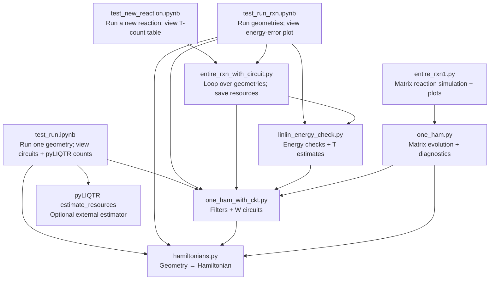

# Chemical reaction simulations — start here

This project builds quantum circuits for molecules and estimates the resources needed to apply them along a chemical reaction path. A **geometry** is one arrangement of atoms. A **trajectory** is an XYZ file containing several geometries. A **W block** is one application of the dissipative circuit.

**Use the notebooks to run calculations and see outputs.** The Python files under `src/dissipative_algorithms/` provide the functions those notebooks call. You do not need to edit those Python files to try a different reaction.

## 1. Install once

Use Python 3.11 or newer. Open a terminal in this `Chemical_rxn-cleaned` folder and run:

```bash
python -m venv .venv
source .venv/bin/activate
python -m pip install -e .
python -m pip install jupyterlab
python -m jupyter lab
```

In Jupyter, select the Python environment you just created. If an import says `No module named dissipative_algorithms`, check the notebook kernel and run `python -m pip install -e .` in that environment from the project folder.

## 2. Open a notebook and see the results

**First-time users: open [examples/test_new_reaction.ipynb](examples/test_new_reaction.ipynb).** It has a settings cell, a run cell, and a results table. A small H3 example has already been executed and saved, so you can see the output before running anything.

| Notebook | What you run and see |
| --- | --- |
| **[test_new_reaction.ipynb](examples/test_new_reaction.ipynb)** | Recommended starting point. Run a trajectory, display qubits, operations, rotations, and estimated T counts; save a CSV. |
| **[test_run.ipynb](examples/test_run.ipynb)** | Original single-geometry experiment. Builds W circuits, displays circuit objects, and calls pyLIQTR's `estimate_resources`. Saved resource outputs are included. The estimation cells require `pyLIQTR`, which is not part of the core install. |
| **[test_run_rxn.ipynb](examples/test_run_rxn.ipynb)** | Original reaction experiment. Builds circuits for the first two H3 frames, simulates energies, and displays an energy-error plot. Edit the trajectory, frame slice, chemistry, occupations, and electron counts to change systems. It currently starts each geometry from a fresh density matrix (`rho_init=None`). |
| [LinLin_channel.ipynb](examples/LinLin_channel.ipynb) | Detailed single-geometry experiments and diagnostic plots. |
| [The_entire_rxn.ipynb](examples/The_entire_rxn.ipynb) | Exploratory reaction-path and resource-estimation work. Some cells require `pyLIQTR` and the external `ham_reduce` module, which is not supplied here. |
| [Pauli_Ham_Qubitized_QPE.ipynb](examples/Pauli_Ham_Qubitized_QPE.ipynb) | Pauli Hamiltonian / qubitized-QPE benchmarking; some cells require `qsppack`. |
| [ORCA-NEB.ipynb](examples/ORCA-NEB.ipynb) | Plot ORCA minimum-energy-path data from `.interp` files. |
| [W_circuits.ipynb](examples/W_circuits.ipynb) | Original circuit-construction sketch. Its saved run contains an error; use `test_new_reaction.ipynb` or `test_run.ipynb` as your starting point. |

For a fresh run, choose **Restart Kernel and Run All Cells**, then **Save**. Saved notebook outputs show a previous run; changing inputs does not update them until you execute the cells again. The older notebooks use larger research settings and can take much longer than the small starter example.

## 3. Run another chemical reaction

Open **`examples/test_new_reaction.ipynb`** and edit its settings cell. The notebook calls **[`entire_rxn_with_circuit.py`](src/dissipative_algorithms/entire_rxn_with_circuit.py)**, which handles the loop over geometries and writes resource results.

### Prepare the input

Use a multi-frame `.xyz` trajectory, such as an ORCA `*_MEP_trj.xyz` file. Every frame has an atom-count line, a comment line, and atom coordinates in Angstrom. Keep atom order consistent between frames. Example of one frame:

```text
3
H3 example; coordinates in Angstrom
H 0.0 0.0 0.0
H 1.0 0.0 0.0
H 1.0 0.0 1.0
```

Set `trajectory = Path("/absolute/path/to/your_reaction_MEP_trj.xyz")`. An absolute path avoids confusion about where Jupyter was launched.

### Change these settings

| Setting in the notebook | What to enter |
| --- | --- |
| `output_dir` | A new output folder for this run, e.g. `Path("results/my-reaction")`. Reusing a folder replaces its result files. |
| `basis` | Your orbital basis, e.g. `"sto-3g"`. Use the same basis when comparing resource estimates. |
| `charge` | Net molecular charge: `0` for neutral, `1` for a cation, etc. |
| `multiplicity` | `2S+1`: `1` for singlet, `2` for doublet, `3` for triplet. |
| `n_electrons` | Electrons represented in the Hamiltonian. Full space: total electrons (sum of atomic numbers minus charge). Active space: active electrons only. |
| `n_active_electrons`, `n_active_orbitals` | Leave both `None` for full space. For an active space, set both; orbitals here means **spatial orbitals**. Set `n_electrons` to the active electron count too. |
| `spin_adapted_jumps` | Choose the jump model for your spin sector. The starter uses `False`; do not copy a singlet-specific setting into every reaction. |
| `geometry_start`, `geometry_stop`, `geometry_stride` | Frames to process, starting at index 0. Stop is exclusive. Start with `0, 1, 1`; set stop to `None` for the remaining trajectory. |
| `filter_K`, `reps_per_W` | Fourier cutoffs. `reps_per_W` limits the modes used in each W block; it is not the number of W applications. |
| `N_applications` | Number of W blocks applied **per geometry**. |
| `trotter_steps_H`, `tau` | Hamiltonian-evolution steps and dissipative timestep. Keep them consistent between comparisons. |
| `t_synthesis_eps` | Per-rotation synthesis precision used for the T estimate; the example uses `1e-10`. |
| `rng_seed` | Controls jump-pair sampling; hold fixed for reproducible comparisons. |

Run all cells and save the notebook. Start with one frame and the small defaults; choose and convergence-check larger settings for a scientific calculation. The starter counts resources only; it does not prove cooling accuracy or simulate the transported state.

### Where are the results?

The final notebook cell shows a table and the absolute output folder. Each row includes **all W applications for one geometry**.

| Output file | Contents |
| --- | --- |
| `resource_summary.csv` | Table written by the notebook: frame, qubits, W applications, depth estimate, operations, rotations, estimated T count. |
| `circuit_resources.json` | Detailed per-geometry results. Counts are in each record's `resources_total`, including `t_count` and `gate_histogram`. |
| `run_metadata.json` | Input file, selected frames, parameters, and run status. |
| `W_sequence_by_geometry.json` | Sampled jump sequence for each geometry. |
| `unique_W_circuits.pkl` | Stored circuits when using compressed circuit construction; not produced by analytic counting. |

**Reading T counts:** the package estimates T gates from arbitrary rotations using approximately `3 × log2(1 / t_synthesis_eps)` T gates per rotation. It does not produce a compiled Clifford+T circuit. This is a different estimation method from pyLIQTR in `test_run.ipynb`; the values need not match. To reproduce that notebook's method, use its `estimate_resources(W_list[0])` cell on your circuit (one W block), with the same estimator settings. `W_list[0][1]` is only one moment, not the complete W circuit.

For the package driver, use **`--analytic-resources`** for counts alone, or **`--compress-circuits`** for counts plus saved circuits. The ordinary uncompressed branch does not fill rotation/T estimates; its zero T field must not be interpreted as zero T cost. Total T cost across the selected path is the sum of the per-geometry T counts; qubit width is the maximum, not the sum.

### Prefer the terminal?

Run **`entire_rxn_with_circuit.py` as a package module**. This is the equivalent small H3 example; replace the input and chemistry options using the table above for your reaction:

```bash
python -m dissipative_algorithms.entire_rxn_with_circuit \
  --xyz-trajectory src/dissipative_algorithms/H3_rxn_trj.xyz \
  --geometry-start 0 --geometry-stop 1 \
  --basis sto-3g --multiplicity 2 --charge 0 --n-electrons 3 \
  --n-active-electrons none --n-active-orbitals none --fix-spin-ss none \
  --no-spin-adapted-jumps --no-align-orbitals \
  --filter-K 2 --reps-per-W 2 --N-applications 2 --trotter-steps-H 1 \
  --tau-filter 0.1 --tau-W 0.1 --rng-seed 123 \
  --analytic-resources --t-synthesis-eps 1e-10 \
  --no-simulate --no-plot --outdir results/my-reaction
```

Omit `--geometry-stop 1` to process the rest of the trajectory. Replace `--analytic-resources` with `--compress-circuits` to retain circuits. The CLI writes JSON results; the notebook also creates the readable table and CSV. Use `python -m dissipative_algorithms.entire_rxn_with_circuit --help` for all options.

## 4. How the notebooks and Python files connect

Arrows mean **calls / uses**. Notebook boxes are the places you execute code and view results. The Python files underneath contain the reusable implementation.



`test_run_rxn.ipynb` imports helpers from the reaction driver and runs its own geometry loop. The starter notebook calls the driver's `run` function directly. The older exploratory notebooks also contain independent code, so they are not all wrappers around these modules.

If your Markdown viewer does not render Mermaid, the main route is: **notebook → reaction runner → resource/circuit functions → Hamiltonian builder**.

## 5. Which Python file should I use or change?

All paths in this table are relative to `src/dissipative_algorithms/`.

| Task | Important file and functions |
| --- | --- |
| Change molecule-to-Hamiltonian construction | [hamiltonians.py](src/dissipative_algorithms/hamiltonians.py): `HamiltonianBuilder.build_molecule`; returns operators, qubits, and spectral width. Set `compute_dense=True` only when you need the dense matrix and energy. |
| Change filter or W circuit construction | [one_ham_with_ckt.py](src/dissipative_algorithms/one_ham_with_ckt.py): `SquareWaveFilter`, `build_W_circuit`, `build_W_circuits_only`. Use `drop_zeros=False` for circuit filters to preserve the Fourier time grid. |
| Change T estimation, gate counting, or energy checks | [linlin_energy_check.py](src/dissipative_algorithms/linlin_energy_check.py): `analytic_resource_rows`, `t_count_from_rotations`, `run_W_chain_energies`. |
| Run a new reaction and save resource estimates | [entire_rxn_with_circuit.py](src/dissipative_algorithms/entire_rxn_with_circuit.py): `build_arg_parser`, `run`. Start with the notebook above; change parameters rather than implementation. |
| Compare explicit matrices and circuits | [one_ham.py](src/dissipative_algorithms/one_ham.py): `WChainDiagnostics`, `build_W_matrix`, `run_W_chain_averaged_matrix`. Dense simulation is for small systems. |
| Run matrix simulation across a trajectory | [entire_rxn1.py](src/dissipative_algorithms/entire_rxn1.py): choose `--evolution-mode averaged_matrix` or `sampled_circuit`; produces energy CSVs and plots. This is not the T-count runner. |
| Use the H3 example in Rottnest | [executables/simple_molecules.py](src/dissipative_algorithms/executables/simple_molecules.py) → [executables/circuit_builder.py](src/dissipative_algorithms/executables/circuit_builder.py) → Hamiltonian/circuit modules. Requires Rottnest separately. |

For energy validation with the resource driver, replace `--no-simulate --no-plot` with `--simulate --plot` for a small system. Set occupations and electron sector correctly. The original `test_run_rxn.ipynb` demonstrates energy plots. Full-space state continuation can use `--align-orbitals`; the builder does not support that alignment with an active space. These choices matter for simulation but are not needed for resource-only runs.

## Inputs, cleanup, and checks

`src/dissipative_algorithms/H3_rxn_trj.xyz` is the bundled H3 trajectory. `reaction_data/` contains other reaction geometries, ORCA inputs, and saved results. Use `*trj.xyz` for trajectory runs and `.interp` with `ORCA-NEB.ipynb` for path-energy plots.

Shared Hamiltonian helpers now live in `hamiltonians.py`; shared filters and circuit builders live in `one_ham_with_ckt.py`. `one_ham.py` imports them while keeping its unique matrix diagnostics. Redundant `.py files/one_ham.py` and the duplicate trajectory were removed. Three differing historical scripts remain under `legacy/` as reference material. Both reaction drivers remain because they support different tasks.

The seven original notebooks and reaction data are preserved, with an additional executed starter notebook. See [VALIDATION.md](VALIDATION.md) for checks and limits. The original ZIP and separate `Chemical_rxn-main` folder are unchanged.
